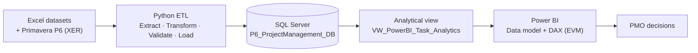
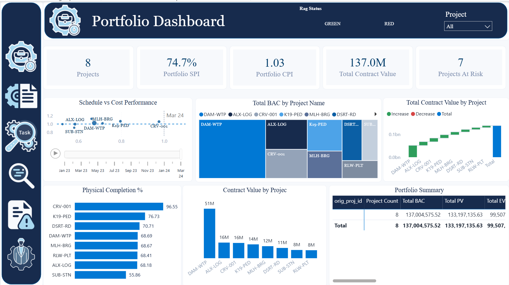
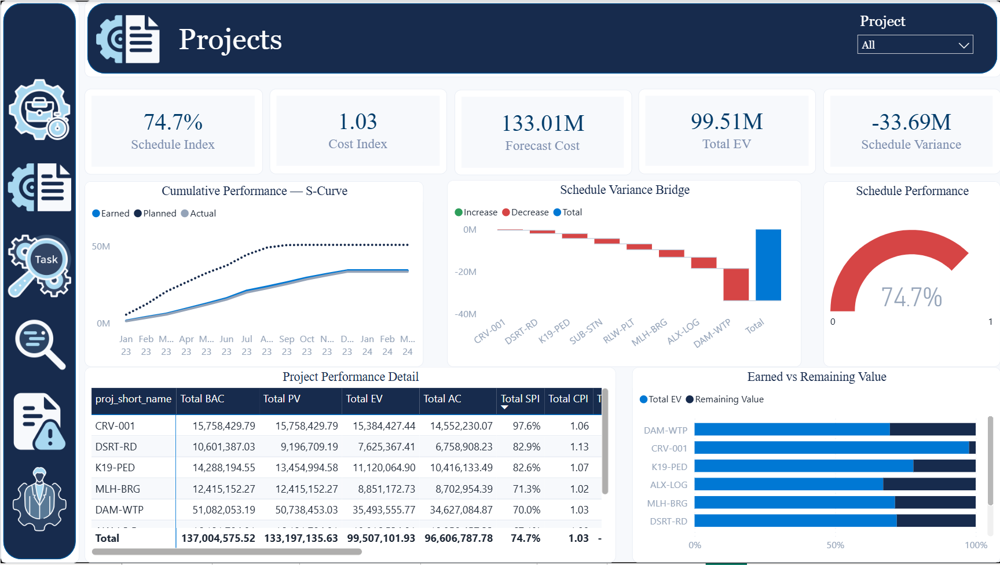
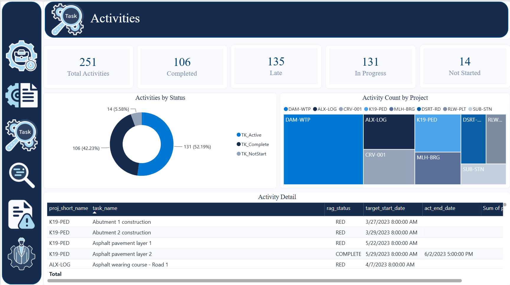
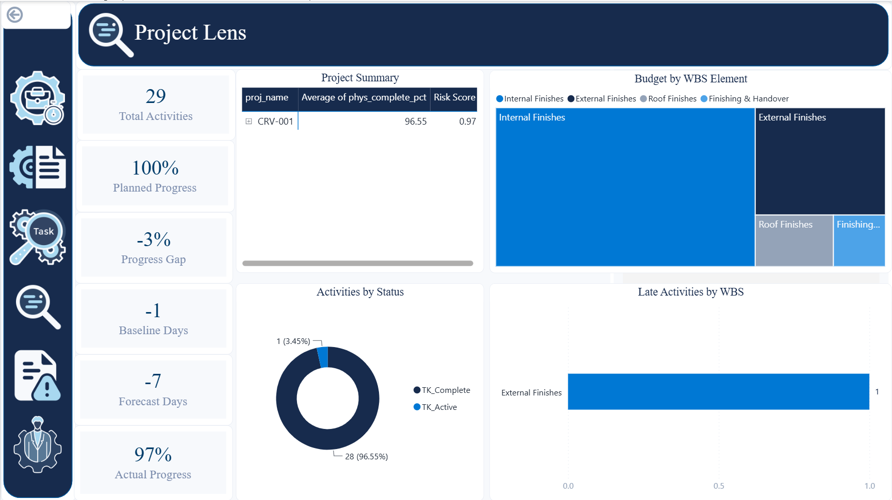
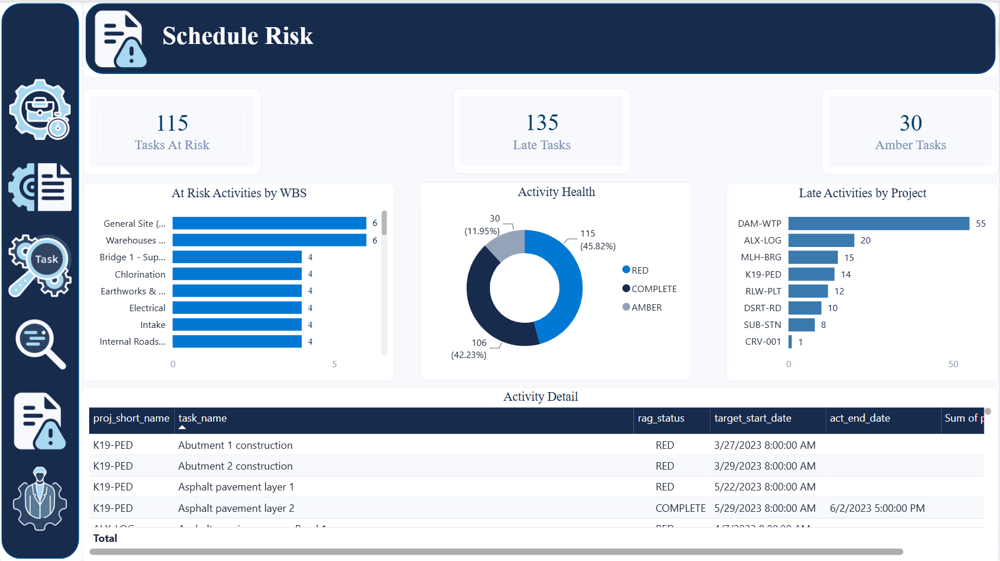
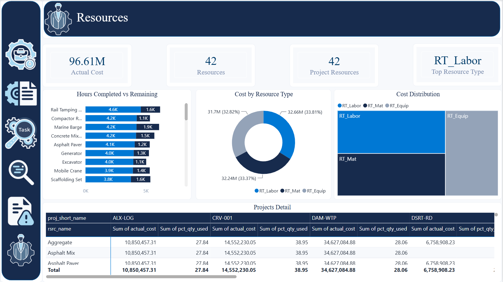

<h1 align="center">📊 PMO Portfolio Project Analysis</h1>
<h3 align="center"><i>From Schedule to Decision — Turning Project Data into Better Decisions</i></h3>

  
  
  
  
  

> **Capstone project** — DIGILIANS Nano Degree, Professional Data Analysts Track (2026)

An end-to-end Business Intelligence platform that connects **Primavera P6** project data to **Power BI** through an automated Python + SQL Server pipeline, so PMO teams get a single, reliable, always-current view of portfolio performance — with RAG-based early-warning views that flag late and at-risk activities.

---

## 🎯 The Problem

Project data lives in different tools and formats, which leads to:

- **Inconsistent KPIs** — schedule, cost, and resource data maintained in separate sources
- **Manual data preparation** — repeated extraction, cleaning, and consolidation that adds effort and errors
- **Disconnected tools** — hard to compare projects at the portfolio level
- **Limited drill-down** — no clear path from portfolio → project → WBS → activity → resource
- **Delayed decisions** — deviations are spotted late because reporting takes too long

## 💡 The Solution

An automated pipeline that integrates the sources, validates the data, stores it in a central SQL Server database, and serves interactive Power BI dashboards built on standard **Earned Value Management (EVM)** metrics.

---

## 🧰 Tech Stack

| Layer | Tools |
|---|---|
| Source data | Excel datasets, Primavera P6 exchange files (`.XER`) |
| Data preparation & ETL | Python, pandas, Visual Studio Code |
| Database | Microsoft SQL Server, SSMS |
| Modeling & analytics | Hybrid star-snowflake model, DAX |
| Visualization | Power BI (drill-through, interactive dashboards) |

## 🗄️ Data

The dataset is an infrastructure-projects portfolio (**8 projects, 251 activities, 42 resources**) structured like Primavera P6 tables, including: `PROJECT`, `PROJWBS` (WBS), `TASK`, `TASKPRED` (relationships), `TASKRSRC`, `RSRC`, `PROJCOST`, `PROJRISK`, `PROJISSU`, `PROJECT_BASELINE`, calendars, a progress snapshot table, and a date dimension.

**Data source:** Al-Nile Company.

## ⚙️ ETL & Data Quality

A modular Python pipeline (**Extract → Transform → Validate → Load**) that:

- Parses Excel sources and Primavera P6 `.XER` files (WBS, schedule, cost, resources)
- Enforces schema and data types, standardizes columns, checks missing values and duplicates
- Creates derived fields and staging datasets for the database load
- Enforces referential integrity — **0 orphan records**
- Loads the validated data into SQL Server and exposes a consolidated view for Power BI

## 📐 PMO KPIs

| Area | Metrics |
|---|---|
| Schedule | SPI (EV / PV), SV, schedule delay & slippage rate |
| Cost | CPI (EV / AC), CV, cost burn rate |
| Forecasting | EAC, ETC, TCPI |
| Progress & risk | Physical completion %, RAG status, at-risk and late activities |

---

## 📊 Power BI Dashboards

A 6-page interactive report with sidebar navigation and drill-through from portfolio down to project, WBS, activity, and resource level.

### 1. Portfolio Dashboard
Executive overview: project count, portfolio SPI and CPI, total contract value, projects at risk, schedule-vs-cost performance by project, budget (BAC) breakdown, and physical completion %.

### 2. Projects
Earned value performance: S-curve (planned vs. earned vs. actual), schedule variance bridge, schedule performance gauge, forecast cost, and a project-level performance table.

### 3. Activities
Activity tracking: total, completed, in-progress, late, and not-started activities, status breakdown, activity count by project, and a detailed activity table.

### 4. Project Lens
Single-project drill-through: planned vs. actual progress, progress gap, baseline and forecast days, budget by WBS element, and late activities by WBS.

### 5. Schedule Risk
Early-warning view: tasks at risk, late tasks, amber tasks, RAG activity health, at-risk activities by WBS, and late activities by project.

### 6. Resources
Resource and cost analysis: actual cost, resource counts, hours completed vs. remaining, and cost distribution by resource type (labor, materials, equipment).

---

## 🔎 Key Insights from the Dashboards

- **Schedule is the main problem, not cost:** portfolio SPI is about 0.75 (behind schedule) while CPI is 1.03 (slightly under budget).
- **7 of 8 projects** are flagged at risk, with a schedule variance of about −33.7M.
- **135 of 251 activities (54%) are late**, and DAM-WTP alone accounts for 55 of them.
- Costs are split roughly evenly across **labor, materials, and equipment** (about a third each).

## ✅ Testing & Validation

Data quality testing · ETL validation · referential integrity · KPI validation · dashboard and performance testing.

## 👩‍💻 My Role — Team Leader

- Led the team and coordinated the project end to end
- Collected and prepared the infrastructure project data
- Contributed to the Primavera P6 → Power BI integration
- Designed, built, and finalized the Power BI dashboards

## 🤝 Team

**Tasneem El-Abd** (Team Leader) · Noha Ahmed · Nourhan Omar · Aya Sleem · Omima Mohamed

**Supervision:** Prof. Dr. Rania ElGohary (Supervisor) · Mohamed El-Alfy (Instructor) · Dr. Ahmed Zakaria (Track Head)

## 🚀 Future Work

- **Predictive risk model** — a machine learning model to predict schedule-risk activities before they fall behind
- **ERP integration** — API connectivity with SAP and Microsoft Dynamics 365 for direct financial and resource syncing
- **Cloud deployment** — migrate the pipeline to Azure/AWS for scalability
- **Mobile PMO app** — daily site progress reporting for field engineers and approvals for management

## 📁 Files

- 📥 [PMO Power BI report (.pbix)](PMO-Portfolio-Dashboard.pbix) (requires Power BI Desktop)
- 🖼️ Dashboard screenshots: `01-portfolio-dashboard.png` … `06-resources.png`

---

## 📬 Contact

**Tasneem Elabd** — [LinkedIn](https://www.linkedin.com/in/tasneem-elabd-data-analytics114) · tasneemelabd63@gmail.com
